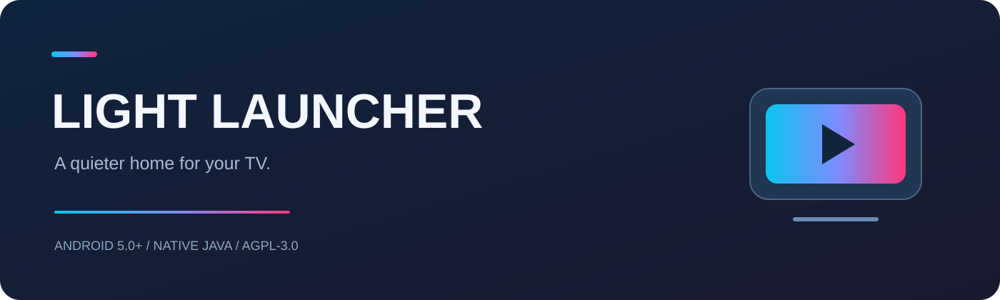
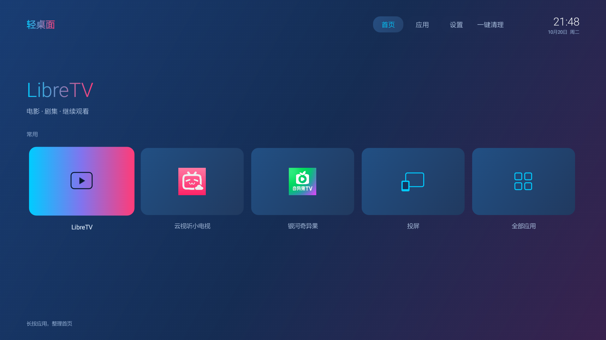
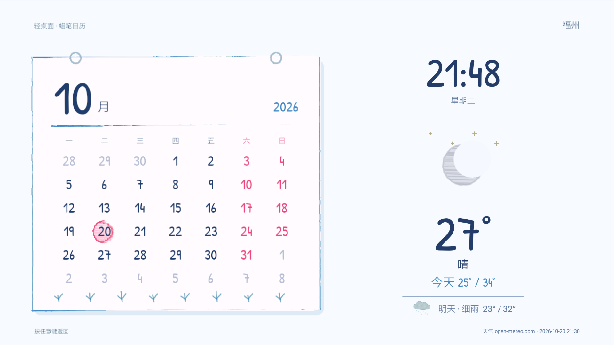
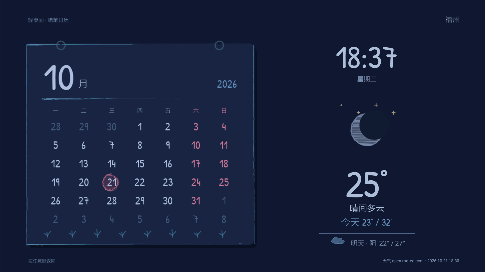

<div align="center">



# 轻桌面 · M13 Light Launcher

**让旧电视盒子，回到简单好用的样子。**
A minimal Android TV home with native video search, casting and a crayon weather clock.

[](https://github.com/QQ-L-XX/m13-light-launcher/releases/latest)


[](LICENSE)

[下载安装 / Download](https://github.com/QQ-L-XX/m13-light-launcher/releases/latest) · [安装说明 / Installation](docs/INSTALL.md) · [构建 / Build](docs/BUILD.md) · [问题反馈 / Issues](https://github.com/QQ-L-XX/m13-light-launcher/issues)

</div>

## 一个更安静的客厅 / A calmer living room

为天猫魔盒 M13 改造的原生 Android 桌面：蓝红渐变、遥控器操作、常用应用入口，以及在盒子本地运行的影视搜索与播放。电脑关机后，桌面、投屏接收和本地搜索逻辑仍能独立工作；在线视频和天气需要盒子联网。

A native Java launcher developed on a MagicBox M13. It runs directly on the box, without a PC server. Online catalogs, streams and weather still need internet access. This is an independent community adaptation, not an official LibreTV, Apple or Tmall product.



*实机界面参考：主页及日间截图来自 2.15，夜间截图来自 2.18。当前本地源码为 2.24，新增屏保明日课程；网易云扫码授权及账号歌曲播放已验证，部分按钮与布局已有更新。Third-party app icons belong to their owners.*

## 功能 / Features

| 模块 / Module | 体验 / Experience |
|---|---|
| 极简桌面 / Home | 蓝红配色、大卡片、遥控器焦点、应用与设置入口。Native TV navigation and app shortcuts. |
| 影视 / Video | 海报首页、分类、中文模糊搜索、拼音与首字母搜索（如 `lldq`）、独立分页、观看记录。Posters, filters, fuzzy/pinyin/initial search, pagination and local history. |
| 片源合并 / Grouping | 同名同年作品合并为海报，进入后选择片源；不同年份、续集等保留区分。Group compatible titles while retaining provider variants. |
| 轻音乐 / Music | 独立搜歌、歌单、网易云扫码登录、账号权限播放、行歌词与校准、收藏及续听。On-device music and NetEase QR account login; see [music scope](docs/MUSIC.md). |
| 视频投屏 / Casting | 同一局域网中的 DLNA/UPnP 视频 App 投屏，设备名“轻桌面 M13”。Video casting; **not AirPlay screen mirroring**. |
| 蜡笔屏保 / Screensaver | 日历、福州今明天气、横向明日课程，按日出日落切换日夜配色。Calendar, two-day weather, tomorrow's classes and sunrise/sunset themes. |
| 后台管理 / Background | 一键后台清理；桌面管理权限下可对指定应用按需启用，检测到媒体活动时保留后台。Playback-aware cleanup and optional on-demand app policies. |

<table><tr><td width="50%"></td><td width="50%"></td></tr><tr><td align="center">日间 / Day</td><td align="center">夜间 / Night</td></tr></table>

日出日落在盒子离线计算，默认福州（26.0745°N, 119.2965°E），使用北京时间。天气通过 Open-Meteo 获取；太阳时刻为当地估算值，不能作为精密观测时间。Solar switching works offline; weather does not.

屏保底部可显示明日课程：七节课横向排列，区分上午与下午，按北京时间跨日切换。课程表保存在盒子应用私有区，默认安装包不包含个人课程、姓名或班级；空课日显示暂无课程。按每周固定课表计算，调休及临时换课需另行更新。[课程配置 / Timetable configuration](docs/TIMETABLE.md). Personal timetables stay on-device and are not bundled in the public APK.

当前公开版本 **2.24** 包含独立音乐、网易云账号登录、歌词校准与明日课程屏保。实机及构建检查见 [验证范围](docs/VALIDATION.md) 与 [音乐验证](docs/MUSIC-VALIDATION.md)。Version 2.24 includes standalone music, NetEase QR login, lyric calibration and the timetable screensaver.

## 开始使用 / Quick start

1. 在 [Releases](https://github.com/QQ-L-XX/m13-light-launcher/releases/latest) 下载完整 APK 和校验文件。Download the full APK and checksum.
2. 在盒子安装 APK，打开“轻桌面”，先验证遥控器导航、播放和返回。Install and test navigation and playback first.
3. 如需默认主页、开机进入与屏保系统配置，阅读 [安装与恢复](docs/INSTALL.md)。Managed-home behavior requires device support and additional provisioning.

```powershell
adb devices -l
adb -s <DEVICE_SERIAL> install -r .\M13-Light-Launcher-2.24.apk
adb -s <DEVICE_SERIAL> shell am start -n local.m13.home/.MainActivity
```

**仅验证过特定 M13 设备环境；不是通刷固件。** Android 5.0+ 是 API 最低要求，不代表已适配所有品牌和新版系统。无需为普通安装获取 Root；本项目不包含 Root 工具、CEC 解锁、原厂固件或开机片头替换。

The minimum API is Android 5.0. Compatibility outside the development M13 is unverified. This APK does not flash firmware or grant root. System boot animations and vendor restrictions remain device-specific.

## 源码与构建 / Source & build

```text
app/AndroidManifest.xml     Package, permissions and components
app/src/local/m13/home/    Native launcher, player, casting and screensaver
app/res/                  Android resources
app/assets/               Title index, pinyin, fonts, CA roots and notices
tools/build.py            Python + Android SDK build; no private key in source
tools/test.py             Offline Java solar/schedule regression checks
tests/                    Host-side checks
docs/                     Installation, build and validation notes
```

需要 Python 3.11+、JDK 21、Android API 22 和 Build Tools 35.0.0。首次构建生成仅供开发的本地签名，私钥保存在忽略目录；正式包使用私有签名。具体环境变量见 [构建说明](docs/BUILD.md)。Python orchestrates the standard Android compiler, D8, aapt, zipalign and apksigner.

```powershell
python tools/test.py
python tools/build.py
```

## 边界与验证 / Scope & validation

- 本次公开版本执行源码构建、签名与 APK 完整性检查、太阳时刻边界回归测试。结果见 [验证记录](docs/VALIDATION.md)。Public build checks are documented separately from device acceptance.
- 历史上 iPhone 视频 App 投屏曾由用户确认画面与声音正常；公开包未重新在每款手机上验收。DLNA reception depends on the sending app and LAN multicast.
- “语音搜片”是可选独立包 `local.m13.voice` 的入口；**本仓库不包含语音识别引擎和模型**。未安装时会提示缺少组件，普通文本搜索可用。Voice is an optional companion integration, not bundled recognition.
- 默认片源是外部服务，可能变化或失效；本项目不托管媒体文件，使用者需确认访问内容的授权。Catalog and stream availability are not guaranteed.
- 片名索引只包含名称和拼音键，不包含影片、播放 URL、剧情或海报。运行时历史保存在盒子本地。Title seed metadata and provenance: [title-seed-info.json](app/assets/title-seed-info.json).
- 投屏没有配对认证，只在可信局域网使用，勿映射端口到公网。Cast control is intended for a trusted LAN.

## 许可证与鸣谢 / License & credits

本地改编源码按 **GNU AGPL-3.0** 发布，保留 [LibreSpark/LibreTV](https://github.com/LibreSpark/LibreTV) 的改编说明。拼音数据来自 [mozillazg/pinyin-data](https://github.com/mozillazg/pinyin-data)（MIT）；Patrick Hand 字体采用 SIL OFL 1.1；Mozilla CA 数据采用 MPL-2.0；天气数据署名 Open-Meteo（CC BY 4.0）。完整说明见 [第三方声明](app/assets/THIRD-PARTY-NOTICES.txt)。这些许可证不授予外部视频内容或第三方商标的使用权。

Adaptation code is distributed under AGPL-3.0; bundled third-party materials retain their licenses. See [LICENSE](LICENSE) and the included notices. No signing private keys, device backups, accounts or viewing histories are included.

[版本记录 / Changelog](CHANGELOG.md) · [反馈与贡献 / Contributing](CONTRIBUTING.md)
